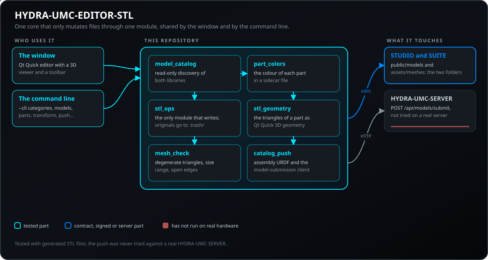
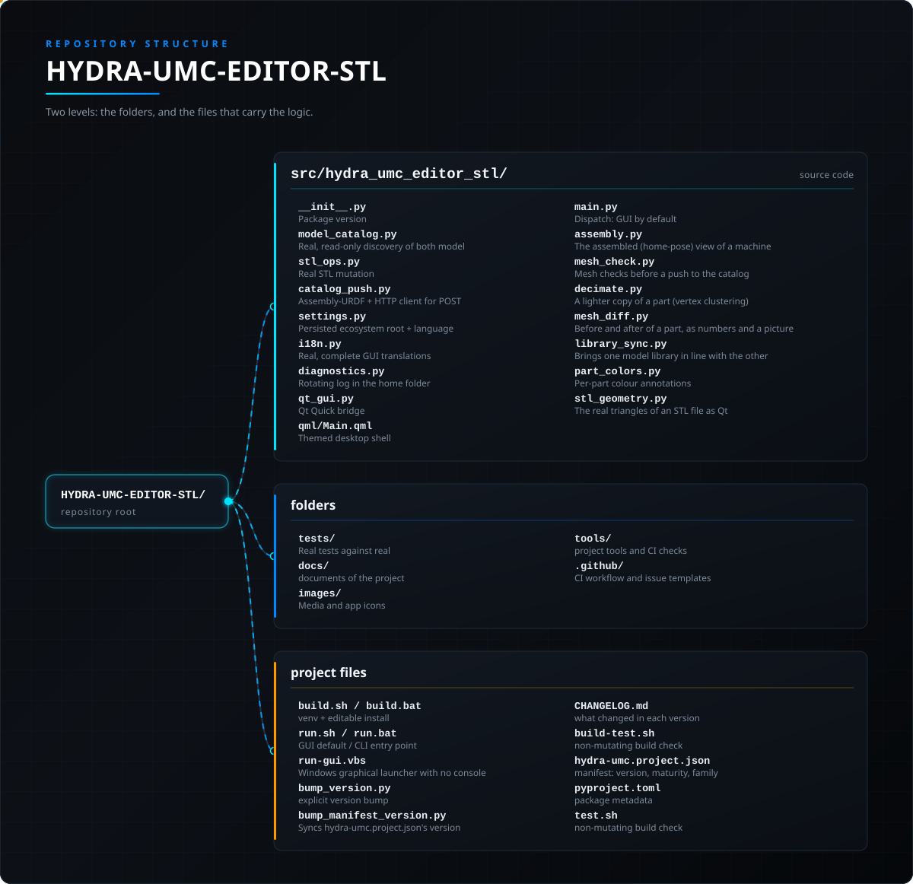

<!-- =============================================================================
HYDRA-UMC-EDITOR-STL - Desktop editor for the STL model libraries of HYDRA-UMC-STUDIO and HYDRA-UMC-SUITE
Copyright (C) JuanenRac (Electro Hobby 3D) <electrohobby3d@gmail.com>
GPL-3.0-or-later - see LICENSE
============================================================================= -->

<p align="center">
  
</p>

# 📦 HYDRA-UMC-EDITOR-STL

<p align="center"><a href="README.md">🇺🇸 English</a> | <a href="README_spa.md">🇪🇸 Español</a> | <a href="README_fra.md">🇫🇷 Français</a> | <a href="README_ita.md">🇮🇹 Italiano</a> | 🇩🇪 <b>Deutsch</b> | <a href="README_zho.md">🇨🇳 简体中文</a> | <a href="README_jpn.md">🇯🇵 日本語</a> | <a href="README_por.md">🇵🇹 Português</a></p>

### 📦 Die Echten STL-Modellbibliotheken des HYDRA-UMC-Ökosystems Durchsuchen und Bearbeiten

<p align="center">
  
  
  
  
  
  
  
</p>

---

**Ehrlichkeitscheck - was heute wirklich läuft:** `model_catalog.py`
(echte, schreibgeschützte Erkennung beider Modellbibliotheken),
`stl_ops.py` (echte STL-Mutation via `numpy-stl` - transformieren/
ersetzen/entfernen/hinzufügen, plus `model_bounds()` für die
Kamera-Einrahmung des 3D-Viewers), `part_colors.py` (echte
Sidecar-Datei für Farbe pro Teil), `stl_geometry.py` (echtes Laden
von Qt-Quick-3D-Geometrie) und `catalog_push.py` (echte Erzeugung
eines Assembly-URDF plus ein echter HTTP-Client für
`POST /api/models/submit`) sind alle gegen echte, generierte
STL-Dateien und, wo nötig, eine echte, sitzungsweite
`QGuiApplication` getestet (`pytest tests/`, 237 bestandene Fälle) und
wurden End-to-End gegen die echten `HYDRA-UMC-STUDIO`/`HYDRA-UMC-SUITE`-
Checkouts dieses Ökosystems verifiziert (`--cli categories`/`models`/
`parts` gegen die echten Bäume; `transform`/`remove` gegen eine
Wegwerfkopie, niemals den echten Checkout). Der eigene `EditorBridge`
von `qt_gui.py` wird ebenfalls direkt getestet (der Farb-Slot, die
Auswahl bleibt nach einem Farbwechsel erhalten). `qml/Main.qml` lädt
und rendert ohne QML-Fehler (verifiziert ohne Anzeige mit
`QT_QPA_PLATFORM=offscreen`, auch mit den echten Teilen eines Modells,
die in den 3D-Viewer geladen wurden), der QML-Szenengraph selbst hat
aber keinen eigenen automatisierten Test - eine echte
Qt-Ereignisschleife zu steuern wird hier nicht versucht, dieselbe
Ehrlichkeitsgrenze, die das eigene README von HYDRA-UMC-UPDATER bereits
für seine eigene Qt-Quick-Schicht
zieht.

---

> **Stand von Sicherheit (Safety) und Security:** Dieses Ökosystem ist kein zertifiziertes Sicherheitssystem. Es gibt noch keinen Hardware-E-STOP-Pfad, keine von der Firmware durchgesetzten Grenzen oder Verriegelungen und keinen verifizierten Bewegungsbefehl; Firmware-Images werden mit CRC-32 und einer Ed25519-Signatur geprüft, und ein Release-Build verweigert die veröffentlichten Entwicklungsschlüssel (die Werkzeugköpfe und Erweiterungsplatinen hinter dem Relais laufen noch mit URTC-Bootloadern, die statt einer Signatur ein HMAC-SHA256 mit gemeinsamem Schlüssel verwenden); TLS und gegenseitiges TLS sind optional und standardmäßig aus; noch keine eigene Platine wurde bestückt oder getestet. Lesen Sie die [Sicherheitsbasis](https://github.com/JuanenRac/HYDRA-UMC-DOCS/blob/main/docs/SECURITY_BASELINE.md) und das [Bedrohungsmodell](https://github.com/JuanenRac/HYDRA-UMC-DOCS/blob/main/docs/THREAT_MODEL.md), bevor Sie sich für die Sicherheit einer Person auf eine Aussage hier verlassen.

---

## 📋 Auf einen Blick

| | |
|---|---|
| Version | `0.1.8` |
| Reifegrad | Gerüst |
| Tests | 237 (`python -m pytest tests -q`) |
| Technik | Python / PySide6 / Qt Quick / numpy-stl |
| Ziel | Der PC der Person, die es benutzt |
| Auf echter Hardware | Nicht zutreffend: nichts hiervon läuft auf Hardware |

**Springe zu:** [Überblick](#-überblick) · [Architektur](#-architektur) · [Sicherheit und Schutz](#-sicherheit-und-schutz) · [Schnittstellen](#-schnittstellen) · [Konfiguration](#-konfiguration) · [Schnellstart](#-schnellstart) · [Tests](#-tests) · [Fehlerbehebung](#-fehlerbehebung) · [Struktur des Repositorys](#-struktur-des-repositorys) · [Verwandte Projekte](#-verwandte-projekte)

## 🚦 Projektstatus

Jede Zeile ist ein Teil dieses Repositorys, und die Ampel sagt, wie weit er heute ist. Sie beruht auf dem, was das Repository zeigen kann (Tests, Builds, Läufe), nicht auf dem, was geplant ist.

🟢 Fertig und überprüft · 🟡 Funktioniert, mit bekannten Grenzen · 🟠 Teilweise fertig oder noch nicht überprüft · 🔴 Nicht gemacht oder funktioniert nicht

| Bereich | Stand | Was das hier bedeutet |
|---|---|---|
| Software | 🟠 | Nur Struktur und erste Teile; der größte Teil der Arbeit steht noch aus |
| Tests | 🟡 | 237 automatische Tests, bei jeder Änderung ausgeführt |
| Echte Hardware | 🟡 | Nicht zutreffend: nichts hiervon läuft auf Hardware |
| Dokumentation | 🟡 | README in acht Sprachen, bei jeder Änderung gegen das Manifest geprüft |

## 🎯 Überblick

HYDRA-UMC-EDITOR-STL ist ein kleines Desktop-Werkzeug - standardmäßig
Fenster-GUI, vollständige CLI mit `--cli` - zum Bearbeiten der echten
STL-Teile, aus denen jedes Roboter-/Maschinenmodell besteht, das
HYDRA-UMC-STUDIO und HYDRA-UMC-SUITE ausliefern. Beide Apps haben ihre
eigenen Modellordner in dieselbe echte Kategoriestruktur
umorganisiert (`robots-5-dof`/`robots-6-dof`/`robots-7-dof`,
`machine-pnp`/`machine-cnc`/`machine-laser`,
`heatedbeds`/`racks`/`vacuum-tables`, jedes Modell mit eigener
`metadata.json` neben seiner `ATTRIBUTION.txt`) - dieses Werkzeug liest
genau diese echte Struktur, keine separate Kopie und keine eigene
Datenbank.

Ein echter Qt-Quick-3D-Viewer rendert jedes bearbeitbare Teil des
ausgewählten Modells (`stl_geometry.py`, ein echtes `QQuick3DGeometry`,
das die Dreiecke jedes Teils direkt aus dessen STL-Datei lädt) - Ziehen
zum Umkreisen, Mausrad zum Zoomen, Klick auf ein Teil zum Auswählen
(echtes `View3D.pick()`, keine Schätzung). Die Kamera rahmt sich selbst
auf die echte, kombinierte Bounding-Box des Modells ein
(`model_bounds()` aus `stl_ops.py`), sodass eine 400mm-Roboterbasis und
eine 5mm-Schraube beide korrekt eingerahmt werden.

Sechs echte Operationen, jede gestützt auf echte Datei-E/A gegen den
echten Checkout auf der Festplatte:

- **Transformieren** - die echten Vertices eines Teils verschieben/
  drehen/skalieren (via `numpy-stl`, dieselbe Bibliothek, von der
  bereits `render/mesh.py` von HYDRA-UMC-SUITE abhängt) und wieder am
  selben Ort speichern.
- **Farbe ändern** - eine echte Farbanmerkung pro Teil
  (`part_colors.json`, eine eigene Sidecar-Datei dieses Tools) in der
  3D-Ansicht angezeigt - eine binäre STL trägt keine zuverlässige eigene
  Farbe, daher ist diese Sidecar-Datei die echte Quelle der Wahrheit.
  Sowohl HYDRA-UMC-STUDIOs eigenes `hooks/usePartColors.ts` als auch
  HYDRA-UMC-SUITEs eigenes `render/part_colors.py` lesen genau dieselbe
  Datei zurück, sodass eine hier gespeicherte Farbe auch deren echte
  3D-Viewer erreicht, nicht nur die Vorschau dieses Tools.
- **Ersetzen** - ein Teil mit einer anderen echten STL-Datei
  überschreiben.
- **Entfernen** - ein Teil aus einem Modell herausnehmen.
- **Hinzufügen** - eine neue echte STL-Datei in ein Modell einbringen.
- **An Server senden** - die aktuellen bearbeitbaren Teile des
  ausgewählten Modells an den echten Modell-Einreichungskatalog eines
  laufenden HYDRA-UMC-SERVER senden (`catalog_push.py`,
  `POST /api/models/submit` - erfordert einen Admin-Login, genau wie die
  entsprechende Funktion von HYDRA-UMC-EDITOR-URDF). Da der Vertrag
  dieses Endpunkts URDF-förmig ist, verpackt dies die Teile in das
  kleinste echte URDF, das er akzeptiert: ein Wurzel-Link plus ein
  ungelenktes (`fixed`) Kind-Link pro Teil, da die tatsächliche Position
  jedes Teils bereits in dessen eigenen STL-Vertices verankert ist -
  niemals eine erfundene Pose.
- **Schwebende Viewer-Werkzeugleiste** - Auswählen, Verschieben (ein echtes ziehbares 3-Achsen-Gizmo), Bearbeiten (drehen/skalieren), Farbe, Hinzufügen, Löschen, Fixieren (speichert Verschiebung/Drehung/Skalierung dauerhaft), Kopieren, Einfügen und Ausschneiden, direkt in der 3D-Ansicht. Heizbetten, Vakuumtische und Racks sind unabhängige Größenvarianten, daher zeigt der Viewer nur die ausgewählte statt alle übereinander.
- **Montierte Ansicht** - Roboter, CNC, PnP und Laser öffnen sich bereits in ihrer Grundstellung montiert (aus der Kinematik von HYDRA-UMC-SUITE neben diesem Checkout gelesen, nur Anzeige); eine Schaltfläche der Leiste wechselt zu den Rohteilen zum Bearbeiten.

**Grenzen von Senden und Transformation:** Es werden nur `.stl`-Teile hochgeladen (die übrigen werden gemeldet), der gesamte Upload muss in das 50-MB-Anfragelimit des Servers passen, und das Modell wird nur im Katalog des Servers gespeichert (HYDRA-UMC-STUDIO liest es noch nicht). Die Identitätspose passt für unabhängige Teile (Heizbetten, Racks, Vakuumtische); die Teile eines Roboters oder einer Maschine liegen in ihrem eigenen Link-Koordinatensystem und kommen daher am Ursprung gestapelt und ohne Gelenke an. Bevorzugen Sie einen `https://`-Host (oder `HYDRA_UMC_PASSWORD` / die Passwortabfrage statt `--password`). Eine Transformation skaliert zuerst, dreht dann um X, Y und Z und verschiebt zuletzt; die Drehung erfolgt um den Ursprung der Datei, nicht um die Mitte des Teils.

**Nichts wird jemals dauerhaft gelöscht.** Ein Entfernen oder Ersetzen
verschiebt zuerst die echte Originaldatei in den eigenen
`.trash/`-Unterordner dieses Modells - dieselbe "niemals zerstören,
zur Seite verschieben"-Disziplin, der die internen Arbeitskonventionen
dieses Ökosystems bereits folgen, hier als echtes Produktmerkmal
angewendet, nicht nur als interne Gewohnheit.

## 🧩 Rolle in HYDRA-UMC

**HYDRA-UMC-EDITOR-STL** ist das Desktop-Werkzeug, das die echten STL-Teile jedes Roboter- und Maschinenmodells bearbeitet, das HYDRA-UMC-STUDIO und HYDRA-UMC-SUITE mitliefern. Es liest deren beide Modellordner unverändert, zeigt ein Modell in einem Qt-Quick-3D-Betrachter und transformiert, färbt um, ersetzt, entfernt oder fügt ein Teil auf der Platte hinzu, wobei das Original beiseitegelegt statt gelöscht wird. Ein fertiges Modell lässt sich an den Modellkatalog eines HYDRA-UMC-SERVER senden.

## 🏛️ Architektur

<p align="center">
  
</p>

### ARCHITEKTUR UND DESIGNENTSCHEIDUNGEN

- **Zwei echte Bibliotheken, ein Erkennungsmodul.** Die eigene
  `LIBRARIES`-Konstante von `model_catalog.py` benennt beide echten
  Bäume, die dieses Werkzeug bearbeitet
  (`HYDRA-UMC-STUDIO/public/models/`,
  `HYDRA-UMC-SUITE/assets/meshes/`) - eine dritte Bibliothek später
  hinzuzufügen bedeutet, dort einen Eintrag hinzuzufügen, keine zweite
  Erkennungsimplementierung.
- **`stl_ops.py` ist der einzige Ort, der jemals eine Datei mutiert.**
  `model_catalog.py` bleibt strikt schreibgeschützt; sowohl `--cli` als
  auch die Qt-Quick-Brücke rufen exakt dieselben Funktionen
  `transform_part()`/`replace_part()`/`remove_part()`/`add_part()`
  auf, sodass die GUI niemals etwas tun kann, was die CLI selbst nicht
  könnte.
- **Ein echtes STL, nicht nur ein Dateiname, der auf `.stl` endet.**
  `is_real_stl()` analysiert einen Kandidaten für Ersatz/Hinzufügung
  wirklich mit `numpy-stl`, bevor er jemals in einen echten
  Modellordner kopiert wird - und, eine echte Lücke, die beim
  Schreiben der eigenen Tests dieses Projekts gefunden wurde, lehnt
  auch ein Analyseergebnis mit **0 Dreiecken** ab: der eigene
  ASCII-Fallback-Pfad von `numpy-stl` löst bei beliebigen
  Datenmüll-Bytes keine Ausnahme aus, sondern parst sie still als
  leeres Mesh, sodass ein einfaches try/except allein eine Datei
  durchgelassen hätte, die überhaupt kein STL ist.
- **Qt-Quick-GUI standardmäßig, `--cli` für Systeme ohne Anzeige.**
  `main.py` importiert PySide6 nur auf dem Nicht-`--cli`-Pfad, sodass
  `--cli categories`/`models`/`parts`/`transform`/`replace`/`remove`/
  `add` auf einer Maschine ohne Anzeige oder überhaupt installierte
  Qt-Laufzeit funktionieren.
- **Dieselbe echte visuelle Schicht wie HYDRA-UMC-UPDATER.**
  `qml/Main.qml` verwendet die eigenen Komponenten `GameButton`/
  `GameCombo`/`SectionPanel` jenes Projekts und dessen dunkles
  Cyan/Blau/Bernstein/Rot-Thema wortwörtlich weiter, auf ausdrücklichen
  Wunsch des Projektinhabers - ein neues PC-Werkzeug in diesem
  Ökosystem soll sich wie dasselbe Werkzeug anfühlen, nicht wie ein
  separat gestaltetes.
- **Ökosystem-Wurzel, kein fester Pfad.** Wie die eigene
  Workspace-Wurzel von HYDRA-UMC-UPDATER ist das übergeordnete
  Verzeichnis dieses Projekts selbst der Standardwert
  (`default_ecosystem_root()` von `main.py`), immer überschreibbar
  (`--root` bei `--cli`, "Durchsuchen" in der GUI) und über
  GUI-Starts hinweg gemerkt (`settings.py`).

## 🔒 Sicherheit und Schutz

| Bedrohung | Abwehr | Wo |
|---|---|---|
| Ein Teil beim Ersetzen oder Entfernen verlieren | Das Original wird zuerst in den Ordner `.trash/` des Modells verschoben und nie gelöscht; Wiederherstellen ist möglich, und das Leeren des Papierkorbs braucht eine ausdrückliche Bestätigung | `stl_ops.py` |
| Eine Datei, die kein STL ist, oder ein Teilname, der den Modellordner verlässt | Ein Ersatz oder Neuzugang wird zuerst geparst und abgelehnt, wenn er keine Dreiecke hat oder abgeschnitten ist; ein Teilname muss ein einfacher `.stl`-Dateiname im Modellordner sein; eine Transformation, die nicht endliche Eckpunkte ergäbe, ändert nichts | `stl_ops.py`, `mesh_check.py` |
| Das Serverpasswort im Shell-Verlauf oder in der Prozessliste | `--password` wird nicht empfohlen; ohne es wird das Passwort aus `HYDRA_UMC_PASSWORD` gelesen oder ohne Echo abgefragt; ein `https://`-Host vermeidet das Senden im Klartext | `main.py`, `catalog_push.py` |
| Ein zu großer oder hängender Upload | Der gesamte Upload muss in 49 MiB passen (das Serverlimit ist 50 MB) und jede Anfrage hat ein Zeitlimit von 20 s; nur `.stl`-Teile werden gesendet, die übrigen werden gemeldet | `catalog_push.py` |
| Protokolle, die wachsen oder Daten enthalten | Ein rotierendes Protokoll im Home-Ordner mit 256 KiB und zwei Kopien | `diagnostics.py` |

**Was es nie tut:** etwas außerhalb der Modellordner bearbeiten, auf die du es zeigst, oder ein Teil endgültig löschen. Das Senden an einen Server wurde gegen dessen dokumentierten Vertrag geschrieben und nie mit einem echten Server erprobt.

Das Senden eines Roboter- oder Maschinenmodells an einen Katalog wird standardmäßig abgelehnt, weil seine Teile am Ursprung gestapelt ankämen; nur Kategorien unabhängiger Teile (Betten, Racks) gehen durch. Die Ablehnung nennt den Grund, und Teile, die keine `.stl` sind, werden gemeldet.

## 🔌 Schnittstellen

| Topic oder Route | Was es trägt |
|---|---|
| `--cli categories \| models \| parts <library> [...]` | listet auf, was da ist: die Kategorien, die Modelle einer Kategorie, die Teiledateien eines Modells (`--json` für Maschinen); die Bibliothek ist `studio` oder `suite` |
| `--cli transform <library> <category> <model> <part> [--tx --ty --tz --rx --ry --rz --scale]` | verschiebt, dreht und skaliert ein Teil an Ort und Stelle: erst skalieren, dann um X, Y und Z drehen, dann verschieben, um den Ursprung der Datei |
| `--cli replace \| remove \| add` | ersetzt ein Teil durch eine andere STL, verschiebt eines nach `.trash/` oder holt eine neue STL herein (`--dest-filename` benennt sie um) |
| `--cli push <library> <category> <model> --host --username` | sendet die bearbeitbaren Teile eines Modells an `POST /api/models/submit` eines Servers (Administrator-Anmeldung; `--port` standardmäßig 3000, `--server-category`, `--overwrite`) |
| `--root <folder>` | die Ökosystem-Wurzel, die `HYDRA-UMC-STUDIO` und `HYDRA-UMC-SUITE` nebeneinander enthält; standardmäßig der übergeordnete Ordner dieses Werkzeugs |

`--allow-stacked-push` bei `--cli push` und das Kästchen **Erzwingen** im Sendefenster (standardmäßig aus, in allen acht Sprachen) lassen ein Roboter- oder Maschinenmodell an den Katalog gehen, obwohl seine Teile am Ursprung gestapelt ankämen.

## ⚙️ Konfiguration

Es gibt keinen Server und keine von Hand zu bearbeitende Konfigurationsdatei: Das Fenster merkt sich seine Auswahl in einer Datei, und jedes Modell hält seine Farben in einer Begleitdatei.

| Variable | Standard | Was sie festlegt |
|---|---|---|
| `~/.hydra_umc_editor_stl_settings.json` | keiner | die Ökosystem-Wurzel und die im Fenster gewählte Sprache, über Starts hinweg gemerkt |
| `part_colors.json` (in each model folder) | `#9fb4c9` | die Farbe jedes Teils; eine binäre STL trägt keine, und STUDIO und SUITE lesen dieselbe Datei |
| `HYDRA_UMC_PASSWORD` | nicht gesetzt | das Serverpasswort für `--cli push`, damit es nicht in der Befehlszeile steht |
| `~/.hydra_umc_editor_stl.log` | 256 KiB x 3 | das rotierende Protokoll von Fenster und Befehlszeile |

## 🚀 Schnellstart

Benötigt Python 3.10 oder neuer. Die erste Zeile baut eine virtuelle Umgebung mit dem GUI-Extra und führt Prüfungen und Tests aus; unter Windows gibt es `build.bat` und `run.bat`.

```bash
./build.sh                                    # creates .venv, installs the package with the GUI extra, checks and tests
./run.sh                                      # the windowed editor
./run.sh --cli categories studio              # lists the categories of the STUDIO library (use suite for the SUITE one)
./run.sh --cli parts studio robots-6-dof ar3  # lists the part files of one model
```

## 🧪 Tests

237 automatische Tests laufen mit `python -m pytest tests -q`. Sie brauchen weder Hardware noch etwas außerhalb dieses Rechners.

Die CI führt `HYDRA_UMC_CI=1 python tools/ci_validate.py` aus; das prüft das Manifest, die Dokumente, die acht READMEs und die Bilder.

## 🏗️ Build und Veröffentlichung

```bash
chmod +x build.sh   # einmalig
./build.sh          # erstellt .venv, pip install -e ".[dev,gui]", kompiliert und testet
./run.sh                                                    # Fenster-GUI (Standard)
./run.sh --cli categories studio                            # listet Kategorien in einer Bibliothek
./run.sh --cli models studio robots-6-dof                   # listet Modelle in einer Kategorie
./run.sh --cli parts studio robots-6-dof ar3                 # listet die echten Teildateien eines Modells
./run.sh --cli transform studio robots-6-dof ar3 base_link.STL --tz 10
./run.sh --cli replace studio robots-6-dof ar3 base_link.STL /pfad/neu.stl
./run.sh --cli remove studio robots-6-dof ar3 base_link.STL
./run.sh --cli add studio robots-6-dof ar3 /pfad/neu.stl
./run.sh --cli lite studio robots-6-dof ar3 --ratio 0.2          # leichtere Kopien in .lite/ (Originale bleiben unberührt)
./run.sh --cli diff studio robots-6-dof ar3 base_link.STL --svg diff.svg   # mit der in .trash/ gesicherten Version vergleichen
./run.sh --cli sync-libraries --master studio --target suite   # nur der Plan; mit --apply wird geschrieben, nichts wird gelöscht
./run.sh --cli push studio robots-6-dof ar3 --host 192.168.1.100 --username admin
```

Unter Windows: `build.bat`, dann `run.bat` (GUI) oder
`run.bat --cli ...` / Doppelklick auf `run-gui.vbs` für einen
konsolenfreien GUI-Start.

`library` ist immer `studio` oder `suite`; `category`/`model` sind die
echten Ordnernamen, die `categories`/`models` gerade ausgegeben haben.
`--root` überschreibt die Ökosystem-Wurzel für jeden `--cli`-Befehl
(Standard: das eigene übergeordnete Verzeichnis dieses Werkzeugs).

## 🩺 Fehlerbehebung

- `categories`/`models`/`parts` gibt nichts aus: die Ökosystem-Wurzel
  enthält `HYDRA-UMC-STUDIO`/`HYDRA-UMC-SUITE` tatsächlich nicht als
  Geschwister - `--root` explizit angeben oder "Durchsuchen" in der
  GUI verwenden.
- `transform`/`replace`/`add` schlägt fehl mit "not a real, parseable
  STL file": die Quelldatei ist tatsächlich kein gültiges STL (oder
  eines mit 0 Dreiecken) - in einem echten CAD-/Mesh-Viewer öffnen, um
  das zu bestätigen.
- Ein entferntes/ersetztes Teil ist nicht aus der eigenen Teileliste
  der GUI verschwunden: es wurde tatsächlich auf der Festplatte nach
  `.trash/` verschoben - die Teileliste zeigt nur echte, aktuelle
  Dateien der obersten Ebene, und ein `.trash/`-Unterordner ist
  absichtlich davon ausgeschlossen.

| Du siehst | Weil | Tu |
|---|---|---|
| „Senden erfolgreich, aber der Server lieferte keinen Slug“ oder ein Anmeldefehler | Der Server hat das Konto abgelehnt (das Senden braucht einen Administrator), ist kein HYDRA-UMC-SERVER oder hat etwas geantwortet, das kein JSON-Objekt ist | Nutze ein Administratorkonto auf einem echten HYDRA-UMC-SERVER mit dessen Adresse und Port |
| „die Transformation würde nicht endliche Eckpunkte erzeugen (zu groß?) – nichts wurde geändert“ | Skalierung oder Verschiebung sind so groß, dass die Zahlen nicht mehr in einen 32-Bit-Float passen | Nutze kleinere Werte |
| „Das Leeren des Papierkorbs braucht eine ausdrückliche Bestätigung“ | Nichts wird endgültig gelöscht, wenn du es nicht bestätigst | Stelle den Eintrag aus `.trash/` wieder her oder bestätige das Leeren im Fenster |

## 📂 Struktur des Repositorys

<p align="center">
  
</p>

<details>
<summary>Textversion des Baums</summary>

```text
HYDRA-UMC-EDITOR-STL/
├── src/hydra_umc_editor_stl/   Quellcode
│   ├── __init__.py             Paketversion
│   ├── model_catalog.py        Echte, schreibgeschützte Erkennung beider Modellbibliotheken
│   ├── stl_ops.py              Echte STL-Mutation: transformieren/ersetzen/entfernen/hinzufügen, .trash/-Sicherungen
│   ├── catalog_push.py         Assembly-URDF + HTTP-Client für POST /api/models/submit
│   ├── settings.py             Persistierte Ökosystem-Wurzel und Spracheinstellung
│   ├── i18n.py                 Echte, vollständige GUI-Übersetzungen (8 Sprachen)
│   ├── diagnostics.py          Rotierendes Protokoll im Home-Ordner und Schutz der Fenster-Slots
│   ├── qt_gui.py               Qt-Quick-Brücke über den echten model_catalog.py/stl_ops.py-Kern
│   ├── qml/Main.qml            Thematisierte Desktop-Hülle, gemeinsam mit HYDRA-UMC-UPDATER
│   ├── main.py                 Dispatch: GUI standardmäßig, --cli für categories/models/parts/transform/replace/remove/add/push
│   ├── assembly.py             Die zusammengesetzte Ansicht (Grundstellung) einer Maschine aus ihren STL-Teilen
│   ├── mesh_check.py           Netzprüfungen vor dem Hochladen in den Katalog
│   ├── decimate.py             Eine leichtere Kopie eines Teils
│   ├── mesh_diff.py            Vorher und nachher eines Teils, als Zahlen und Bild
│   ├── library_sync.py         Gleicht eine Modellbibliothek an die andere an
│   ├── part_colors.py          Farbanmerkungen pro Teil (ein binäres STL bringt keine eigenen mit)
│   └── stl_geometry.py         Die echten Dreiecke einer STL-Datei als Qt-Quick-3D-Geometrie
├── tests/                      Echte Tests gegen echte, generierte STL-Dateien
├── docs/                       Dokumente des Projekts
├── images/                     Medien und App-Icons
├── tools/                      Projektwerkzeuge und CI-Prüfungen
├── .github/                    CI-Workflow und Issue-Vorlagen
├── build.sh / build.bat        venv + editierbare Installation (dev+gui Extras) + Kompilierprüfung + Tests
├── run.sh / run.bat            GUI standardmäßig / CLI-Einstiegspunkt
├── run-gui.vbs                 Grafischer Windows-Launcher ohne Konsolenfenster
├── bump_version.py             ausdrückliche Versionserhöhung
├── bump_manifest_version.py    Synchronisiert die Version von hydra-umc.project.json mit der nativen (--sync)
├── CHANGELOG.md                was sich in jeder Version geändert hat
├── build-test.sh               Build-Prüfung ohne Änderungen
├── hydra-umc.project.json      Manifest: Version, Reifegrad, Familie
├── pyproject.toml              Paketmetadaten
└── test.sh                     Build-Prüfung ohne Änderungen
```

</details>

## 🗺️ Roadmap und bekannte Grenzen

**Bekannte Grenzen heute**

- Eine gepackte, eigenständige GUI-Ausführungsdatei (PyInstaller, nach
  derselben `build_exe.bat`/`.sh`-Konvention wie HYDRA-UMC-SUITE).
- Rückgängig/Wiederholen über die eigene `.trash/`-Historie einer
  Sitzung, statt einer manuellen Dateiwiederherstellung.

## 🌍 Sprachen

Diese README und die Dokumente des Repositorys gibt es in acht Sprachen: Englisch, Spanisch, Deutsch, Französisch, Italienisch, Japanisch, Chinesisch und Portugiesisch (Portugal). Sie entstehen gemeinsam, und die CI prüft, dass die acht Dateien dieselben Abschnitte und dieselben Links haben.

## 🔗 Verwandte Projekte

Dieses Projekt ist Teil des HYDRA-UMC-Robotik-Ökosystems desselben Autors (JuanenRac / Electro Hobby 3D). Gut zu wissen, da sich eine Anfrage tatsächlich auf eines davon statt auf dieses Repository beziehen könnte.

**Übergeordnetes Projekt**
- **[HYDRA-UMC-STUDIO](https://github.com/JuanenRac/HYDRA-UMC-STUDIO)** — Besitzer einer der beiden echten Modellbibliotheken, die dieser Editor liest und schreibt (`public/models/`).

**Direkt Verwandt**
- **[HYDRA-UMC-SUITE](https://github.com/JuanenRac/HYDRA-UMC-SUITE)** — Besitzer der zweiten echten Modellbibliothek, die dieser Editor liest und schreibt (`assets/meshes/`), in genau derselben Kategoriestruktur wie die von STUDIO gepflegt.
- **[HYDRA-UMC-EDITOR-URDF](https://github.com/JuanenRac/HYDRA-UMC-EDITOR-URDF)** — Schwester-Desktop-Editor für die URDF-/Kinematik-Seite desselben Modellkatalogs, statt der rohen STL-Geometrie, die dieses Werkzeug bearbeitet.
- **[HYDRA-UMC-SERVER](https://github.com/JuanenRac/HYDRA-UMC-SERVER)** — Besitzer des echten `POST /api/models/submit`-Endpunkts, an den dieser Editor seine fertigen Bearbeitungen sendet (`catalog_push.py`, „An Server senden..." in der GUI oder `--cli push`).

**Ebenfalls Teil des Ökosystems**

*Kern-Hardware & Plattform*
- **[HYDRA-UMC](https://github.com/JuanenRac/HYDRA-UMC)** — der Entwurf des Motherboards des Roboterarms: CM5-Host + Dual-Core-STM32H745, gedacht zur Koordination von bis zu 8 Werkzeugarmen über CAN-OTA/SPI-OTA (Firmware in einer frühen Phase; noch keine bestückte Platine).
- **[HYDRA-UMC-OS](https://github.com/JuanenRac/HYDRA-UMC-OS)** — reproduzierbare Raspberry-Pi-OS-Produktschicht für die CM5: schreibgeschützter Agent, validierte Konfiguration/Profile, WiFi-Erstkontakt-Provisionierung.
- **[HYDRA-UMC-SDK](https://github.com/JuanenRac/HYDRA-UMC-SDK)** — der gemeinsame JSON-Schema-Vertrag und die Software-Auftragsschranke, gegen die jede Bridge ihre Befehle validiert (keine zertifizierte Sicherheitsfunktion).
- **[HYDRA-UMC-CONNECTOR-HUB](https://github.com/JuanenRac/HYDRA-UMC-CONNECTOR-HUB)** — deklaratives Adaptermanifest-Register und dessen Validator für externe Maschinenkonnektoren; erweitert die Vertragsidee des SDK auf externe Maschinen, ohne die Industrial-Gateway-Projekte zu ersetzen.

*Kern-Backend & Clients*
- **[HYDRA-UMC-ANDROID-CONTROL](https://github.com/JuanenRac/HYDRA-UMC-ANDROID-CONTROL)** — native Android-Steuerungs-App mit biometrischem Login und einer gekoppelten Wear-OS-Begleit-App.
- **[HYDRA-UMC-IOS-CONTROL](https://github.com/JuanenRac/HYDRA-UMC-IOS-CONTROL)** — iOS/iPadOS-Steuerungs-App (Flutter) mit Echtzeit-WebSocket-Synchronisation.
- **[HYDRA-UMC-DSI](https://github.com/JuanenRac/HYDRA-UMC-DSI)** — native Touch-UI für den eingebauten 7"-DSI-Touchscreen, direkt auf der CM5 eingebettet.
- **[HYDRA-UMC-EDITOR-URDF](https://github.com/JuanenRac/HYDRA-UMC-EDITOR-URDF)** — grafischer Desktop-URDF-Ersteller/-Editor mit GitHub-/lokalem Quell-Laden und Live-3D-Vorschau-Bearbeitung.
- **[HYDRA-UMC-BRIDGE-AMR](https://github.com/JuanenRac/HYDRA-UMC-BRIDGE-AMR)** — Koordinationsschranke für AGV-/AMR-Flotten über einen VDA-5050-MQTT-Publisher (nur gegen eine emulierte Flotte getestet).
- **[HYDRA-UMC-BRIDGE-CNC](https://github.com/JuanenRac/HYDRA-UMC-BRIDGE-CNC)** — High-Level-Koordinator für CNC-Zellen mit GRBL-Status-/Steuerbyte-Zugriff (nur gegen einen Emulator getestet).
- **[HYDRA-UMC-BRIDGE-DROIDS](https://github.com/JuanenRac/HYDRA-UMC-BRIDGE-DROIDS)** — Koordinationsschranke für laufende/humanoide Droiden, mit einem Boston-Dynamics-Spot-Befehlssender (nur gegen einen Emulator getestet).
- **[HYDRA-UMC-BRIDGE-LASER](https://github.com/JuanenRac/HYDRA-UMC-BRIDGE-LASER)** — Koordinator für Laserzellen, liest 3 Schlüssel-/Gehäuse-/Verriegelungs-GPIO-Signale (nur gegen einen simulierten Chip getestet; kann keinen Laser scharfschalten oder auslösen).
- **[HYDRA-UMC-BRIDGE-OPENPNP](https://github.com/JuanenRac/HYDRA-UMC-BRIDGE-OPENPNP)** — sicherer Koordinator hoher Ebene des Platinenflusses für OpenPnP Pick-and-Place.
- **[HYDRA-UMC-BRIDGE-PRINTER3D](https://github.com/JuanenRac/HYDRA-UMC-BRIDGE-PRINTER3D)** — sichere Koordinationsgrenze für Moonraker/Klipper-3D-Drucker, mit echten, gegateten Auftragsbefehlen.
- **[HYDRA-UMC-BRIDGE-ROS2](https://github.com/JuanenRac/HYDRA-UMC-BRIDGE-ROS2)** — Koordinator mit einem träge importierten rclpy-ROS-2-Transport (noch nicht gegen eine ROS-2-Installation ausgeführt).
- **[HYDRA-UMC-BRIDGE-UAV](https://github.com/JuanenRac/HYDRA-UMC-BRIDGE-UAV)** — Koordinationsschranke für kameraausgestattete UAVs, mit einem MAVLink-Befehlssender (nur gegen einen Emulator getestet).

*URTC-Werkzeugplattform*
- **[URTC](https://github.com/JuanenRac/URTC)** — Firmware für die physische PCB des Universal Robot Tool Controller, 25+ Werkzeugprofile über CAN-Bus.
- **[URTC-FLASHER](https://github.com/JuanenRac/URTC-FLASHER)** — Desktop-GUI-Flash-Werkzeug für URTC-Boards, CAN-OTA plus Full-Chip-SWD/JTAG.
- **[URTC-TESTER](https://github.com/JuanenRac/URTC-TESTER)** — Desktop-Live-CAN-Bus-Diagnosewerkzeug für URTC-Boards, ein Panel pro Werkzeugprofil.
- **[URTC-WEB-STUDIO](https://github.com/JuanenRac/URTC-WEB-STUDIO)** — browserbasierte Alternative zu URTC-TESTER über die Web Serial API, keine lokale Installation nötig.
- **[URTC-GATEWAY](https://github.com/JuanenRac/URTC-GATEWAY)** — Gateway vor dem CAN-Bus von URTC: Liste erlaubter Kennungen, Ratenbegrenzung und Sitzungsschlüssel; Software auf dem Computer getestet, noch nicht an einem echten Bus.

*Vision-KI-Knoten (Hailo-8)*
- **[HYDRA-UMC-VISION-NODE](https://github.com/JuanenRac/HYDRA-UMC-VISION-NODE)** — Integrationshub für die Hailo-8-Vision-Pipeline, mit einer echten Hardware-Bereitschaftsprüfung pro Stufe.
- **[HYDRA-UMC-DETECTION-HEF](https://github.com/JuanenRac/HYDRA-UMC-DETECTION-HEF)** — echtes Register kompilierter Modelle mit Hailo-Architektur-/Prüfsummen-Sicherheitsladeverifikation.
- **[HYDRA-UMC-VISION-STREAMER](https://github.com/JuanenRac/HYDRA-UMC-VISION-STREAMER)** — echter GStreamer-Pipeline- + MediaMTX-Konfigurationsgenerator mit einer echten HailoRT-Integrationsgrenze.
- **[HYDRA-UMC-VISUAL-SERVOING-API](https://github.com/JuanenRac/HYDRA-UMC-VISUAL-SERVOING-API)** — Position-Based-Visual-Servoing-Korrekturgesetz mit Freigabe abhängig vom Zonenstatus; noch keine Posenschätzung per Kamera.
- **[HYDRA-UMC-SAFETY-ZONES](https://github.com/JuanenRac/HYDRA-UMC-SAFETY-ZONES)** — v0-Logik für Zonenverletzung, Kalibrierungsaktualität und E-STOP-Anforderung, die Objektpositionen aus einer Datei nimmt; kein Detektor speist sie, und noch kein physischer E-STOP ist angeschlossen.

*Kognitiver KI-Knoten (Hailo-10)*
- **[HYDRA-UMC-COGNITIVE-NODE](https://github.com/JuanenRac/HYDRA-UMC-COGNITIVE-NODE)** — Integrationshub für die Hailo-10-Kognitiv-Pipeline (LLM-/VLA-/Sprachorchestrierung).
- **[HYDRA-UMC-VLA-ENGINE](https://github.com/JuanenRac/HYDRA-UMC-VLA-ENGINE)** — echte Aktions-Token-Kodierung/-Dekodierung und Trajektoriengenerierung für ein Vision-Language-Action-Modell.
- **[HYDRA-UMC-VOICE-UI](https://github.com/JuanenRac/HYDRA-UMC-VOICE-UI)** — echtes Sprach-Frontend (VAD + Intent-Parser) mit einem begrenzten, bestätigungsgegateten Watch-Relay.
- **[HYDRA-UMC-SEMANTIC-PLANNER](https://github.com/JuanenRac/HYDRA-UMC-SEMANTIC-PLANNER)** — echte regelbasierte Aufgabenzerlegung und semantische Fehlerbehebung über MCU-Fehlercodes.
- **[HYDRA-UMC-DOCS-QA](https://github.com/JuanenRac/HYDRA-UMC-DOCS-QA)** — echte, nur-stdlib TF-IDF-Dokumentsuche über die eigenen Markdown-Docs dieses Ökosystems.
- **[HYDRA-UMC-LOCAL-TECHNICIAN](https://github.com/JuanenRac/HYDRA-UMC-LOCAL-TECHNICIAN)** — lokaler, richtliniengegateter KI-Wartungstechniker für das Ökosystem selbst - beobachtet, diagnostiziert und schlägt Korrekturen vor; die beiden höchsten Risikostufen sind absichtlich noch nicht implementiert.

*Orchestrierung & Schwarm*
- **[HYDRA-UMC-ORCHESTRATOR](https://github.com/JuanenRac/HYDRA-UMC-ORCHESTRATOR)** — Integrationshub mit einem echten gRPC/Protobuf-Health-Report-Vertrag und einer Missions-Zustandsmaschine.
- **[HYDRA-UMC-JOB-DISPATCHER](https://github.com/JuanenRac/HYDRA-UMC-JOB-DISPATCHER)** — echte prioritätsbasierte Job-Warteschlange mit Deduplizierung, über eine echte HTTP-API.
- **[HYDRA-UMC-NODE-HEALING](https://github.com/JuanenRac/HYDRA-UMC-NODE-HEALING)** — echter gRPC-basierter Flotten-Health-Watchdog mit Retry/Backoff und Identitätsabweichungserkennung.
- **[HYDRA-UMC-PATH-PLANNER-3D](https://github.com/JuanenRac/HYDRA-UMC-PATH-PLANNER-3D)** — echter RRT-basierter 3D-Pfadplaner mit echter Hindernis-/Arbeitsraum-Kollisionsvalidierung.
- **[HYDRA-UMC-SWARM-SYNC](https://github.com/JuanenRac/HYDRA-UMC-SWARM-SYNC)** — echte CRDT-LWW-Element-Map-Zustandssynchronisation, property-getestet für Multi-Zellen-Konvergenz.

*Digitaler Zwilling & Simulation*
- **[HYDRA-UMC-TWIN](https://github.com/JuanenRac/HYDRA-UMC-TWIN)** — echter physikalischer Simulations-Digital-Zwilling, der die von HYDRA-UMC-EDITOR-URDF erzeugten URDF-Modelle konsumiert.
- **[HYDRA-UMC-PHYSICS-REPLICA](https://github.com/JuanenRac/HYDRA-UMC-PHYSICS-REPLICA)** — konsumiert dieselben URDF-Modelle für seine eigene Physiksimulation.
- **[HYDRA-UMC-SYNTHETIC-DATA-GEN](https://github.com/JuanenRac/HYDRA-UMC-SYNTHETIC-DATA-GEN)** — generiert Trainingsdaten aus denselben Modellen.
- **[HYDRA-UMC-HIL-BRIDGE](https://github.com/JuanenRac/HYDRA-UMC-HIL-BRIDGE)** — Hardware-in-the-Loop-Router mit einer Software-Kollisionsverriegelung zwischen Simulation und echter Hardware (ohne echte Hardware getestet).

*Daten & Analytik*
- **[HYDRA-UMC-DATALAKE](https://github.com/JuanenRac/HYDRA-UMC-DATALAKE)** — echter, sqlite3-gestützter Zeitreihenspeicher mit einer echten Ingest-/Query-HTTP-API.
- **[HYDRA-UMC-ANOMALY-DETECTOR](https://github.com/JuanenRac/HYDRA-UMC-ANOMALY-DETECTOR)** — echter FFT- + statistischer Baseline-Anomaliedetektor mit Drift-Überwachung.
- **[HYDRA-UMC-PRODUCTION-REPORTS](https://github.com/JuanenRac/HYDRA-UMC-PRODUCTION-REPORTS)** — echte OEE-/Verfügbarkeitsberechnung über die DATALAKE-Historie, mit reproduzierbarem CSV-Export.
- **[HYDRA-UMC-TELEMETRY-COLLECTOR](https://github.com/JuanenRac/HYDRA-UMC-TELEMETRY-COLLECTOR)** — echte CAN-/WebSocket-Ingest-Pipeline in DATALAKE, mit Sequenz-Deduplizierung.

*Industrielles Gateway*
- **[HYDRA-UMC-GATEWAY-INDUSTRIAL](https://github.com/JuanenRac/HYDRA-UMC-GATEWAY-INDUSTRIAL)** — Integrationshub, der zu Industrieprotokollen weiterleitet, mit einer echten Befehls-Allowlist-/Gegendruckschicht.
- **[HYDRA-UMC-OPCUA-SERVER](https://github.com/JuanenRac/HYDRA-UMC-OPCUA-SERVER)** — echter OPC-UA-Adressraum, mit einer echten Binärprotokoll-Client-Sitzung verifiziert.
- **[HYDRA-UMC-MQTT-BROKER](https://github.com/JuanenRac/HYDRA-UMC-MQTT-BROKER)** — echter MQTT-Broker mit optionaler Authentifizierung pro Client und Topic-ACLs.
- **[HYDRA-UMC-MTCONNECT-ADAPTER](https://github.com/JuanenRac/HYDRA-UMC-MTCONNECT-ADAPTER)** — echte MTConnect-`/probe`- und `/current`-XML-Endpunkte mit Ausgabe im Degraded-Modus.

*Ergänzende Werkzeuge & Ökosystembetrieb*
- **[HYDRA-UMC-DASHBOARD-AI](https://github.com/JuanenRac/HYDRA-UMC-DASHBOARD-AI)** — Smart-Summaries- und Anomaly-Highlighting-Panels über DATALAKE/ANOMALY-DETECTOR, mit einem ehrlichen statistischen Fallback.
- **[HYDRA-UMC-TOOL-CLI](https://github.com/JuanenRac/HYDRA-UMC-TOOL-CLI)** — Flotten-CLI mit einem echten, stabilen Exit-Code-Vertrag, einem echten Live-Client der eigenen API von HYDRA-UMC-SERVER.
- **[HYDRA-UMC-WATCH](https://github.com/JuanenRac/HYDRA-UMC-WATCH)** — WearOS-Begleit-App mit haptischen Alarmmustern und einem Sprach-Relay zum gekoppelten Telefon (noch nicht auf einer physischen Uhr ausgeführt).
- **[URTC-SMART-RACK](https://github.com/JuanenRac/URTC-SMART-RACK)** — Firmware für ein Board-Montage-Rack mit echter Werkzeug-ID-Dekodierung und Smart-Idle-Vorheizlogik.
- **[URTC-VISION-TOOL](https://github.com/JuanenRac/URTC-VISION-TOOL)** — Firmware plus ein echter Python-Vision-Begleiter für einen Thermal-/RGB-Inspektionswerkzeugkopf.
- **[HYDRA-UMC-UPDATER](https://github.com/JuanenRac/HYDRA-UMC-UPDATER)** — administratives Desktop-Werkzeug, das jedes Repo in diesem Ökosystem entdeckt, klont und aktualisiert, und der Ursprung der eigenen Qt-Quick-visuellen Schicht dieses Projekts.
- **[HYDRA-UMC-OS-REBUILDER](https://github.com/JuanenRac/HYDRA-UMC-OS-REBUILDER)** — Windows/Linux-Desktop-Werkzeug, das ein flash-fertiges CM5-Image erstellt, vorgeladen mit den aktuellsten Versionen des Ökosystems, mit Raspberry-Pi-Imager-artiger Erstboot-WLAN-/Benutzer-/SSH-Konfiguration.
- **[HYDRA-UMC-OPS-AGENT](https://github.com/JuanenRac/HYDRA-UMC-OPS-AGENT)** — Wartungsvorfall-Koordinator: eine Edge-Rolle mit niedrigem Privileg sammelt eine bereinigte Bestands-/Gesundheitsmomentaufnahme, eine Control-Plane-Rolle zeigt sie schreibgeschützt an und bittet einen KI-Anbieter um eine Diagnose - wendet nie einen Patch an oder deployt irgendetwas.
- **[HYDRA-UMC-DEV-SERVER](https://github.com/JuanenRac/HYDRA-UMC-DEV-SERVER)** — reproduzierbarer Entwicklungshost (Raspberry Pi 5 / CM5), der den Quellcode des Ökosystems speichert und begrenzte Build-/Test-Aufgaben unter einer dauerhaften Warteschlange ausführt; eine dedizierte Entwicklungsrolle, ausdrücklich keine operative CM5.

## 📚 Dokumentation

Hier steht mehr:

* [`docs/CLI_REFERENCE.md`](docs/CLI_REFERENCE.md) - jeder echte `--cli`-Unterbefehl, Argument für Argument.
* [Sicherheitsgrundlage des Ökosystems](https://github.com/JuanenRac/HYDRA-UMC-DOCS/blob/main/docs/SECURITY_BASELINE.md)
* [Bedrohungsmodell des Ökosystems](https://github.com/JuanenRac/HYDRA-UMC-DOCS/blob/main/docs/THREAT_MODEL.md)
* [Änderungsprotokoll dieses Repositorys](CHANGELOG.md)
* [Lizenz dieses Repositorys](LICENSE.md)

## 🤝 Mitwirken und Community

* Führe vor einem Pull Request `HYDRA_UMC_CI=1 py -3 tools/ci_validate.py` (oder `HYDRA_UMC_CI=1 python3 tools/ci_validate.py`) aus: Es muss `CI_VALIDATION=PASS` ausgeben. Führe dafür nicht `build.sh` oder `build.bat` aus; Bauen ist keine Prüfung.
* Die acht READMEs entstehen aus einer einzigen Quelle in HYDRA-UMC-DOCS; bearbeite sie nicht von Hand. Ändere die Quelle und schreibe sie mit `tools/make_readmes.py` neu.
* Behaupte in einer README nichts, was nicht gelaufen ist: Schreibe „simuliert“ oder „nicht auf Hardware erprobt“, wo das stimmt.
* Siehe [CONTRIBUTING.md](CONTRIBUTING.md), den [Verhaltenskodex](CODE_OF_CONDUCT.md), [SECURITY.md](SECURITY.md) und [SUPPORT.md](SUPPORT.md).

## 👤 AUTOR

**JuanenRac (Electro Hobby 3D)** · electrohobby3d@gmail.com

## 📜 LIZENZ

GPL-3.0-or-later - [LICENSE](LICENSE).
